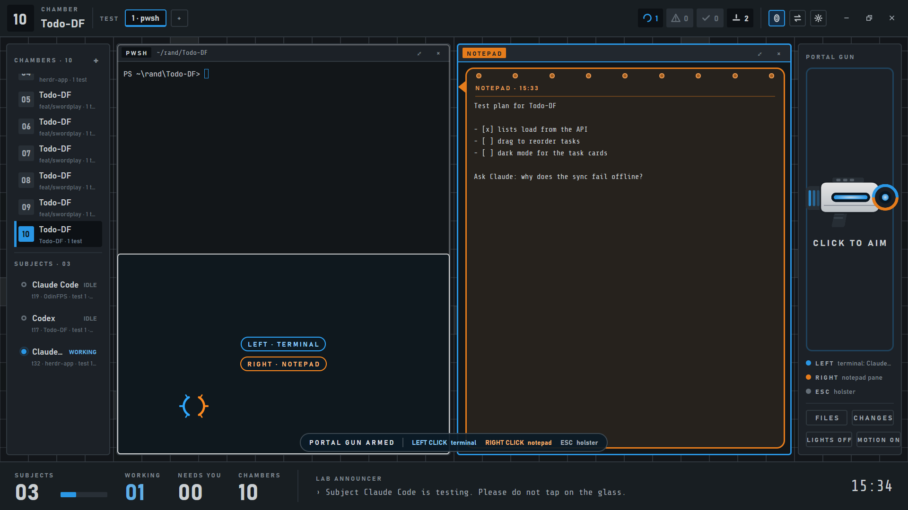

# Test Chamber

A testing-lab layout for the [Herdr](https://herdr.dev) app, inspired by the Portal
games. It is built from original names and art only. It has lab panels, a status HUD, and a
portal gun that aims at your panes: left-click opens a terminal (Claude Code, Codex or a shell),
right-click opens a notepad pane.

## Install

Copy these into `~/.config/herdr-app/`:

- `layouts/test-chamber.json` and `layouts/test-chamber.svg`
- `themes/test-chamber.json` and `themes/test-chamber-dark.json`
- the `mods/test-chamber/` folder

Then run `herdr-app check ~/.config/herdr-app/mods/test-chamber` and
`herdr-app do layout.switch --name test-chamber`. Never overwrite an existing file: if a name is
taken, rename the new one.

**What it runs:** `hc send`, only after you pick an agent in the portal chooser. **Network:**
none. **Files it writes:** only `~/.config/herdr-app/data/test-chamber/fired/note-*.md` (notepad
panes).

[RECIPE.md](RECIPE.md) is the brief for building it from scratch.

Fonts: Barlow Semi Condensed and Share Tech Mono, under the SIL Open Font License (see
`mods/test-chamber/fonts/`).
