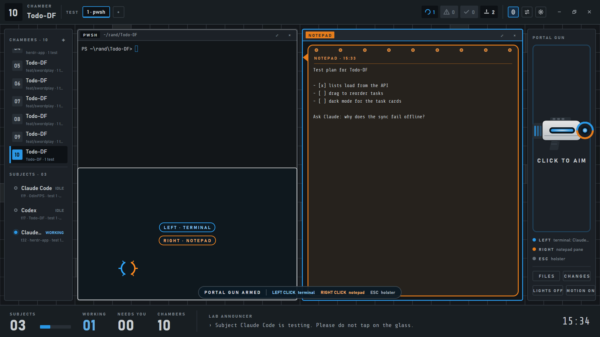

# Test Chamber

A testing-lab layout for Herdr, inspired by the Portal games but built only from
original names and art. Spaces are numbered **chambers**, tabs are **tests** and agents are
**subjects**. Lab panels surround the terminals, and a status HUD runs along the bottom. Blue
always means focus and working; orange always means an agent needs you. The right panel holds a
**portal gun**. Click it, and a reticle follows the pointer over your panes and projects where a
new pane would open. Left-click fires a terminal (then pick Claude Code, Codex or a plain shell);
right-click fires a notepad pane that saves itself. A LIGHTS switch flips the whole lab between
light and dark.

## What you see

The window has no system title bar (`"titlebar": "none"`). Top to bottom it has a 72 px bar, a
middle row, and a 94 px HUD. The font for signs and labels is Bahnschrift where it's installed
(Windows), and otherwise the bundled Barlow Semi Condensed. Monospace text uses the bundled Share
Tech Mono.

**Palette.** Each part paints itself from one palette that has a light and a dark mode:

| name | light | dark | used for |
|---|---|---|---|
| panel | `#e2e6e9` | `#1f252b` | side and gun panels, unfocused pane headers |
| bar | `#e6e9ec` | `#1b2126` | top bar, HUD |
| paper | `#f2f4f6` | `#262d34` | inactive tab tiles, focused pane header |
| seam | `#b0b8bf` | `#353e46` | 2 px panel borders |
| rule | `#c5cbd1` | `#2e363e` | 2 px dividers |
| ink / ink2 | `#1d2329` / `#4b545c` | `#e1e6ea` / `#b3bcc4` | text |
| label / faint | `#5f6870` / `#7d868e` | `#8e98a1` / `#6f7a84` | small caps labels, secondary text |
| chip / hover | `#cfd5da` / `#d5dade` | `#2c343c` / `#2a3239` | number chips, hover fill |
| slab / slabText / slabSub | `#1d2329` / `#f2f4f6` / `#9fb3c4` | `#0f1317` / `#e1e6ea` / `#8095a8` | dark blocks: chamber number, active tab, active chamber row |
| blueInk / blueBg | `#2a86cc` / `#d6e9f8` | `#6cc2ff` / `#16304a` | blue text and fills |
| orangeInk / orangeBg | `#c8600a` / `#f8e3cf` | `#ffa95c` / `#3a2614` | orange text and fills |
| green | `#5d8a5d` | `#8fd18f` | done |
| notePaper / sticky | `#f4f1ea` / `#f7f0e0` | `#24221e` / `#2a2620` | notepad paper |

Some colors are the same in both modes: blue `#2fa8ff`, blueDeep `#0b1a26`, blueSoft
`#8fd0ff`, orange `#ff8a1f`, orangeDeep `#261405`, orangeSoft `#ffb26b`, onAccent (text on
blue or orange fills) `#1d2329`, alarm `#ff6a3a`. Signage is spaced caps: GPUI has no letter
spacing, so a space is put between letters.

**Top bar (72 px, drag to move the window):**
- **Chamber sign:** a 52×52 slab square holding the space's index as two digits (30 px, bold).
  Beside it a `CHAMBER` label and the space name (22 px, bold).
- **TEST:** a label, then one 34 px tile per tab, reading `1 · name`.
  - **Active tab:** slab fill with a 4 px blue bottom border.
  - **Other tabs:** paper fill with a seam border.
  - **Status marks:** an agent that needs you gives an orange border and a pulsing 9 px orange
    dot; working shows a spinning ring icon; done shows a green check.
  - Then a `+` button.
- **Four status pictograms** (36 px tall), each with a count:
  - **working:** slab, with a blue spinning ring when lit.
  - **needs you:** orange and pulsing when lit, chip otherwise.
  - **done:** chip, with a green check when lit.
  - **idle:** slab.
- **Three outlined 32 px buttons:**
  - **Portal-gun panel:** shows or hides it; the button is blue while the panel shows.
  - **Layouts.**
  - **Settings.**
- **Window buttons** (minimize, maximize/restore, close; 42×32, close hovers `#e5484d`), drawn
  only where the system draws none.

**Middle row:** 12 px padding and 12 px gaps. The background is the theme's canvas (`#c9ced3`
light, `#15191d` dark), under a semi-transparent 80 px tile grid (`wall-grid.svg`, `cover`), so
the same art works in both modes.

- **Left panel, CHAMBERS and SUBJECTS** (268 px; min 200, max 440; radius 6):
  - **Header:** `CHAMBERS · 07` and a `+`.
  - **Chamber rows** (50 px):
    - A 30 px number chip, the name (16 px semibold), and `branch-or-folder · N tests` (12 px)
      underneath.
    - The active row is slab, with a 5 px blue strip at the left and a blue number chip.
    - A status dot shows when the space is working, blocked or done.
  - **Then** a 2 px rule and `SUBJECTS · 06`.
  - **Subject cards:**
    - A status dot, the program name (16 px semibold), and the status word on the right
      (`WORKING` blue, `NEEDS YOU` orange, `DONE` green, `IDLE` faint).
    - A second line reads `t12 · space · test 2 · title`.
    - An agent that needs you gets an orange card (2 px orange border, orangeBg); the focused
      agent gets a blue one.
- **Panes:** the shown tab.
  - **Every pane, even a lone one:** a radius 6 card on the terminal background, with a 2 px
    `#3a434b` border that becomes 3 px `#2fa8ff` when focused. 12 px between panes.
  - **Pane header (34 px):**
    - Paper when focused, panel otherwise, with a 2 px bottom border (blue when focused).
    - A program chip: blue when focused, slab otherwise, orange `NOTEPAD` for notepad panes.
    - The folder in mono with `~` for home.
    - Status: a pulsing orange `NEEDS YOU` tag, a blue dot plus `WORKING`, or `DONE ✓`.
    - `⤢` (zoom, shown when the header is wider than 420 px) and `×` (close, wider than
      200 px).
- **Files / Changes panel:** a hidden 380 px column (min 280, max 900). Surface background,
  2 px `#3a434b` border, radius 6. Inside, a stack of the shipped `files` and `changes` mods.
- **Right panel, the portal gun** (240 px; min 200, max 400; radius 6):
  - A `PORTAL GUN` label.
  - **The gun:** a large clickable area with a 3 px blue glow ring (opacity loop 0.15 to 0.9,
    2.2 s). It holds the gun drawing (196×114, an original side view: dark power cell, lab-white
    body with a glowing core window, and a front emitter ring that is blue on top and orange
    underneath) and `CLICK TO AIM` (17 px).
  - **Three hints:** `LEFT` terminal, `RIGHT` notepad pane, `ESC` holster.
  - **A rule, then two rows of 30 px keys:** `FILES` / `CHANGES` (blue while that panel
    shows), and `LIGHTS ON|OFF` / `MOTION ON|OFF`.

**HUD (94 px):**
- Bar fill with a 2 px seam top border.
- **Counters,** each a 12 px label above a 44 px number:
  - `SUBJECTS`, with a 90×10 bar showing the working share (blue on chip).
  - `WORKING`, in blueInk when above 0.
  - `NEEDS YOU`, orange and pulsing when above 0.
  - `CHAMBERS`.
- A 2 px rule, then `LAB ANNOUNCER` and one mono 17 px line, ending in a blinking blue `▌`.
- A 30 px mono clock on the right.

**Notepad pane** (made by an orange shot) is drawn as a notepad bubble:
- A 14×22 orange triangle (the tail) on the left, pointing back at the pane it split from.
- A card with radius 16, a 3 px orange border and sticky-paper fill.
- Across the top, nine 10 px binder rings (orange fill, orangeInk edge).
- `NOTEPAD · 10:20` (the time it was made), and `saved` on the right after a save.
- A mono 14 px text area.

**Aim mode** (after clicking the gun) is a see-through window over the whole app:
- A faint `#0000001a` tint and the crosshair cursor.
- **Reticle:** 60 px, a blue left arc and an orange right arc. While a button is held, the
  other half dims to 20 %.
- **The pane under the reticle:** outlined (2 px `#ffffff55`).
- **Projection:** the half of that pane on the side nearest the pointer.
  - **While aiming:** a 2 px white outline over `#0b1a2666`, with two pills: `LEFT ·
    TERMINAL` (blue) and `RIGHT · NOTEPAD` (orange).
  - **Left button held:** a ghost terminal with a blue border, a blue-tinted header with a
    `TERMINAL` chip and `release to open`, and a blinking prompt.
  - **Right button held:** a ghost notepad with rings and ruled lines, reading `NOTEPAD ·
    RELEASE TO PLACE`.
- **Banner:** a 36 px pill 112 px above the bottom: `PORTAL GUN ARMED | LEFT CLICK terminal ·
  RIGHT CLICK notepad · ESC holster`.

**Chooser** (after a blue shot): a 320×236 popup centered on the new terminal. Radius 14, 3 px
blue border, panel fill. It reads `BLUE PORTAL OPEN · WHO GOES IN?`, then three 50 px rows,
each with a number chip, a name and a line under it:
1. `CLAUDE CODE`
2. `CODEX`
3. `SHELL` (keep the plain terminal)

**Themes.** `themes/test-chamber.json` (light) and `themes/test-chamber-dark.json` share the
terminal colors:
- background `#14181c`, foreground `#d6dde3`, selection `#1f4a6b`, cursor `#2fa8ff`.
- ANSI: `#1b2127 #ff6b5a #8fd18f #ffb84d #2fa8ff #c79bff #5fd3d3 #c9d1d8 #5c6670 #ff8f80
  #a8e6a8 #ffcc7a #6cc2ff #dcbcff #8ce6e6 #f2f5f7`.
- Panel colors for Herdr's own menus: chrome `#1d2329`, surface `#181d22`, popover `#1b2127`,
  raised `#232a31`, hover `#2a333b`, selected `#1f3a52`, border `#3a434b`, input `#56616b`,
  muted `#aab4bd`, dim `#7c8791`, accent `#2fa8ff`, accent_foreground `#06131d`, working
  `#2fa8ff`, blocked `#ff8a1f`, done `#8fd18f`, idle `#7c8791`.
- They differ only in canvas: `#c9ced3` light, `#15191d` dark.

## How it behaves

- **Agent statuses** look the same everywhere:
  - **working:** blue, with a pulsing ring around the dot in lists, a spinning ring on tab
    tiles, and a blue `WORKING` in pane headers.
  - **blocked (needs you):** orange and pulsing: the tab tile border and dot, the pictogram, the
    subject card, the pane header tag and the HUD counter.
  - **done:** green check or dot, `DONE ✓`.
  - **idle:** a faint hollow dot, `IDLE`.
- **The lab announcer** describes the real state in one original line. Priority runs blocked,
  then done, then working, then all idle, then nobody: for example `Subject Codex (t17) is
  requesting assistance. Please remain calm.`, `Subject Claude Code is testing. Please do not tap
  on the glass.`, `All subjects idle. The lab is quiet. Suspiciously quiet.`
- **Top bar:**
  - **Tab tiles:** click a tile to select it, drag it onto another tile to move it there,
    double-click to rename, right-click for the shipped tab `menu`. The wheel over the tabs
    goes to the next or previous tab.
  - **Spaces:** double-click the space name to rename it.
  - **`+`:** opens the shipped `new-menu`.
  - **Layouts button:** opens a layout-switcher mod if keys.json binds one (any
    `mod.open:<name>` whose name contains "switch"); otherwise it runs `layout.switch`.
- **Left panel:**
  - **Chambers:** click selects a space, double-click renames it, right-click opens the
    space `menu`, `+` runs `space.new`.
  - **Subjects:** clicking one runs `agent.focus`. The list also sets agent order
    (`setAgentOrder`), so `agent.next` and `agent.prev` follow it.
- **Pane headers:** click focuses the pane; `⤢` zooms it, `×` closes it.
- **Portal gun:**
  1. **Click the gun** to enter aim mode.
  2. **Move the pointer:** the projection jumps to the nearest side (left, right, top or
     bottom) of whichever pane it's over.
  3. **Hold and release the left button:** the pane splits there with a new terminal, and the
     chooser opens over it. Picking Claude Code or Codex types that agent's command into the
     new terminal (`claude`, `codex --no-daemon`, or whatever `knownAgents()` lists). Keys 1, 2
     and 3 pick; Esc or a click away keeps the shell.
  4. **Hold and release the right button:** the pane splits there with a notepad pane. It
     saves to `~/.config/herdr-app/data/test-chamber/fired/note-<ms>.md` 0.7 s after typing
     stops, and reloads after a restart.
  5. **Esc, or a release off every pane,** holsters the gun without firing.
- **The new pane** always takes half of the pane it was aimed at.
- **FILES / CHANGES:** show that side panel (`layout.select` and `layout.show`); pressing the
  lit one hides it.
- **LIGHTS:** switches the layout's theme between `test-chamber` and `test-chamber-dark`
  (`app.theme`). Every part follows within a frame.
- **MOTION:** sets shared `chamber.still`, which stops every pulse, spin, glow and blink.
- **Key commands** (not bound by default): `test-chamber.aim` (aim without clicking, using the
  last known pane positions) and `test-chamber.lights`, for example
  `"ctrl-shift-g": "test-chamber.aim"` in keys.json.

## Built from

- **Files:**
  - `layouts/test-chamber.json`, with `layouts/test-chamber.svg` as its settings preview.
  - `themes/test-chamber.json` and `themes/test-chamber-dark.json`.
  - One mod, `mods/test-chamber/`: JS modules, `gun.svg`, `wall-grid.svg`, `icons/*.svg`, and
    `fonts/` (Barlow Semi Condensed Bold/SemiBold/Medium and Share Tech Mono, with their OFL
    licences).
- **Node tree:**
  - Root: a `column` with `titlebar: none`, `traffic_lights: [20, 28]`, `theme:
    "test-chamber"`, `ui_font: "Bahnschrift"`, `terminal_padding: [12, 10]`, `background:
    "canvas"`.
  - Its children:
    - `bar`: block, px 72, `window_drag`, role `bar`.
    - `middle`: row, padding 12, gap 12, background `{image: "mods/test-chamber/wall-grid.svg",
      fit: "cover"}`, holding:
      - `side`: block, px 268, radius 6, role `side`.
      - `work-body`: row, gap 12, holding:
        - `main`: block, `{tab: "active"}`, `pane: {gap 12, radius 6, background
          "background", border 2 #3a434b, focus 3 #2fa8ff, header {mod test-chamber, height
          34, top, always}, lone true}`.
        - `panel`: column, px 380, hidden, holding the stack `panel-body` with `files` and
          `changes`.
      - `gun`: block, px 240, radius 6, role `gun`.
    - `hud`: block, px 94, role `hud`.
  - The side and gun blocks have no layout background or border: the mod paints its own panel,
    so the panel follows light and dark mode.
- **One mod, roles chosen by `props.role`:**
  - `bar`, `side`, `gun`, `hud`: the panels above.
  - `pane`: the pane header; it has no role, only `{pane, terminal}`.
  - `fired`: the notepad pane, `{role, file, at}`.
  - `aim`: the aim window.
  - `chooser`: the popup, `{role, terminal}`.
  - `main.js` dispatches to classes in `bar.js`, `side.js`, `pane.js`, `gun.js`, `hud.js`,
    `note.js` and `aim.js`. `portals.js` does the splitting; `kit.js` holds the palette,
    fonts, geometry store and helpers.
- **Shipped mods it uses:** `files`, `changes`, `menu` (tab and space right-click) and
  `new-menu`.
- **herdr functions:**
  - Data: `spaces`, `agents`, `panes`, `focused`, `layout`, `window`, `keys`, `settings` (for
    `zoom`), `theme` (for canvas), `fonts`, `knownAgents`, `home`, `appHome`.
  - Actions: `run`, `openOverlay`, `closeOverlay`, `notify`, `hc`, `setAgentOrder`,
    `nextCommand`, `checking`.
  - State and files: `shared` and `setShared`, `readTextFile` and `writeTextFile`, plus
    `fs/promises` `mkdir`.
- **Commands it runs:**
  - Spaces and tabs: `space.select`, `space.rename`, `space.new`, `tab.select`, `tab.move`,
    `tab.rename`, `tab.prev`, `tab.next`, `agent.focus`.
  - Panes: `pane.focus`, `pane.zoom`, `pane.close`, `pane.split` (with `mod` and `props` for
    notepads), `pane.swap`.
  - Layout and app: `layout.toggle`, `layout.show`, `layout.hide`, `layout.select`,
    `layout.switch`, `mod.open`, `app.settings`, `app.theme`.
  - Window: `window.minimize`, `window.maximize`, `window.close`.
- **Programs, network and files:**
  - **Programs:** only `hc send <terminal> <agent command>`, and only after you pick an agent
    in the chooser.
  - **Network:** none.
  - **Files:** writes only notepad files under `data/test-chamber/fired/`.
- **Art:** all original.
  - Gun drawing, reticle halves, notepad tail, status icons, window icons and wall grid are
    SVGs drawn for this layout.
  - No Valve logos, characters, quotes or game assets.

## Watch out

- **Copy `themes/` too.** The usual install steps (copy `layouts/` and `mods/`) would miss the
  two theme files, and the layout names its theme.
- **Herdr tells a mod nothing about where panes are.**
  - The trick: every pane header listens to `on_mouse_down_out`. Any press anywhere reports
    that header's box. Origin = `event.position − event.local_position`; size = `event.bounds`.
    The click on the gun therefore refreshes every pane's position.
  - A pane's box runs from its header down to the next header below it, minus the gap. With no
    header below, it runs to the bottom of the gun panel (which records its own box on press).
  - Only boxes from within 3 s of the gun click count, so panes hidden behind a zoom are left
    out.
- **Event coordinates are window pixels, but a mod's px are scaled by the app zoom.** Draw at
  `event / settings().zoom`. Scaling by the header's height (34 px) is wrong: it measures about
  35, not 34 × zoom.
- **The aim window:** `openOverlay({kind: "window", frame: "none", width: 1, height: 1, at:
  {x: 0, y: 0}})`.
  - Stop propagation on its mouse downs, or a press drags the window.
  - Focus a focus handle in `init` so Esc reaches it.
  - Do the split, then close the window from the same task: closing it first cancels the task.
- **`run()` returns null,** so a new pane is found by diffing `panes()` for its tab after
  `pane.split`. Poll up to 2 s; for a terminal, wait until it has an address.
  - `pane.split` only goes right or down. For left and top, split, then `pane.swap {pane: new,
    target: old}`.
- **`"transparent"` is rejected** as a color: use `#00000000`.
- **The bundled Barlow Semi Condensed registers as family `"Barlow"`.** Asking for "Barlow Semi
  Condensed" silently falls back to the default font.
- **`ui_font: "Bahnschrift"` exists only on Windows.** Elsewhere unstyled text falls back to
  Herdr's UI font. The mod's signage picks Barlow itself when `fonts()` lacks Bahnschrift.
- **Light and dark mode:**
  - The palette object is changed in place when the theme changes.
  - Anything captured once at module load keeps stale colors, so the status table uses getters.
  - The mode comes from the luminance of `theme().canvas`, checked before every render.
- **LIGHTS uses `app.theme`,** which fills only the half of the layout's theme that matches the
  theme's own lightness. Both themes have dark terminals, so it sets the dark half. The switch
  therefore works when the system (or settings `appearance`) is dark; in light appearance the
  lab stays light.
- **Layout background images are cached by path.** After changing `wall-grid.svg`, give it a new
  file name, or the old image stays.
- **`herdr-app check` passes no props,** so it only checks the empty fallback. Check each role
  with a copy of the mod whose `main.js` hardcodes that role's props.
- **`props()` answers for whichever copy is running.** Keep `overlay` and other props in
  instance fields in `init`.
- **Limits:**
  - Closing a notepad pane keeps its file: `close()` also runs on quit, so it can't tell the
    two apart.
  - The chooser types the agent command into the shell with `hc send`, rather than starting
    the terminal with that program.
  - Splits are 50/50.
- **The layouts button** depends on what keys.json binds: a person without a switcher mod gets
  Herdr's `layout.switch` cycle.

## Done when

- `herdr-app check mods/test-chamber` passes. So does a copy for each role, hardcoding `{role:
  "bar" | "side" | "gun" | "hud" | "aim"}`, `{role: "chooser", terminal: "t1"}`, `{role:
  "fired", file, at}` and `{pane: "p1", terminal: "t1"}`.
- `herdr-app do layout.switch --name test-chamber` shows the bar, both panels, the panes and the
  HUD, and `herdr-app status` lists no errors.
- An agent that needs you turns its tab tile, pictogram, subject card, pane header and HUD
  counter orange and pulsing, and the announcer says it's requesting assistance.
- Clicking the gun opens the aim window. Over a pane, the outline and projection line up exactly
  with that pane's edges, at app zoom 1 and at other zooms.
- Left-click release on the right side of a pane puts a new terminal to its right, and the
  chooser appears over it. Pressing 3 closes the chooser and keeps the shell; pressing 1 starts
  Claude Code in it.
- Right-click release on the top side of a pane puts a notepad pane above it. Typing writes
  `data/test-chamber/fired/note-<ms>.md` within a second, and the text is back after a restart.
- Esc in aim mode closes it without changing any pane.
- LIGHTS switches every panel, the bar and the HUD between the light and dark palettes (with
  the system in dark appearance); MOTION stops every animation.
